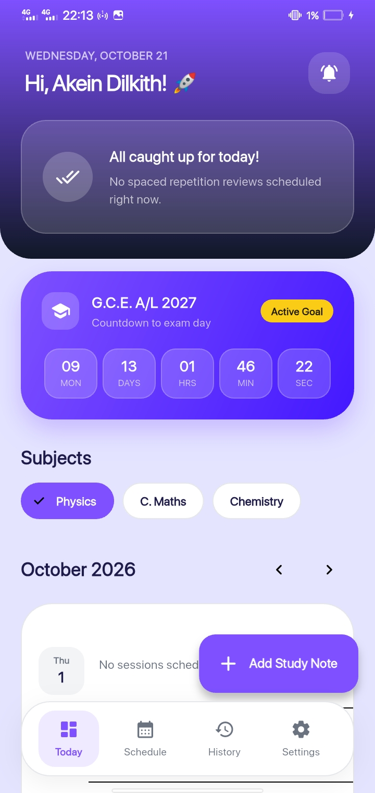
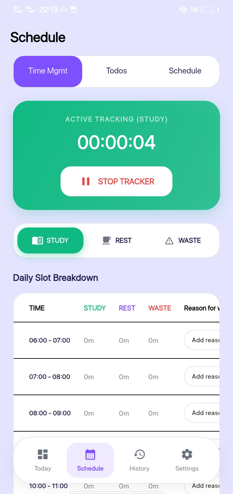
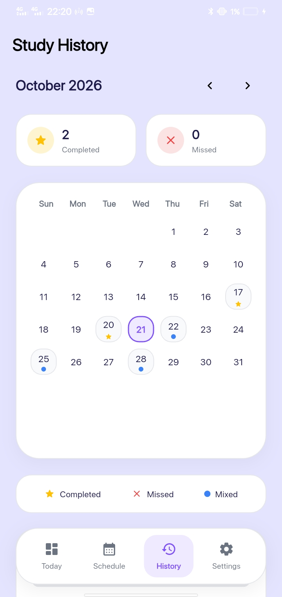

  

### Study Smart

A smart study planning application that uses automated spaced repetition algorithms to systematically transition daily lessons into long-term memory. 
Master subjects effortlessly, manage weekly schedules, and never miss a review session again!

---

 
 
 

## 🌃 Features

- 🧠 **Smart Spaced Repetition**: Automatic review scheduling with configurable interval patterns (e.g., `3, 6, 14, 30` or multiplier syntax like `30*12`).
- 🔔 **Automatic Reminders**: Local push notifications automatically scheduled for 12:00 AM on every day you have pending study reviews.
- ⏱️ **Advanced Time Management**: Live session tracking between **STUDY**, **REST**, and **WASTE** categories with an hourly breakdown table (`Reason for wasting time` notes) and visual analytics history charts.
- 📊 **Interactive Dashboard**: Hero overview banner, today's review task slider, subject filter pills, and a quick task creation sheet.
- ⏳ **Live Exam Countdown**: Real-time countdown timer tracking years, months, days, hours, minutes, and seconds remaining until exams.
- 📅 **Schedule & Time Planner**: Weekly timetable across Monday to Sunday with customizable time slots.
- 📝 **Reorderable Todo List**: Smooth drag-and-drop task management with instant checkboxes.
- 📜 **History & Review Tracker**: Full monthly calendar view displaying status badges for completed (⭐️), missed (❌), or mixed (🔵) review days.
- 🔒 **Privacy First**: 100% offline-first architecture with local data storage and zero telemetry or tracking.

## 📜 ⬇️ Installation guide

This table lists the available installation method for Study Smart:

<table>
  <tr>
    <th>Platform</th>
    <th>Package / Installation Method</th>
  </tr>
  <tr>
    <td>Android (v0.0.2)</td>
    <td>
      
       
      
Download the standalone APK for <b>Android v0.0.2</b> directly from GitHub Releases.

    </td>
  </tr>
</table>

